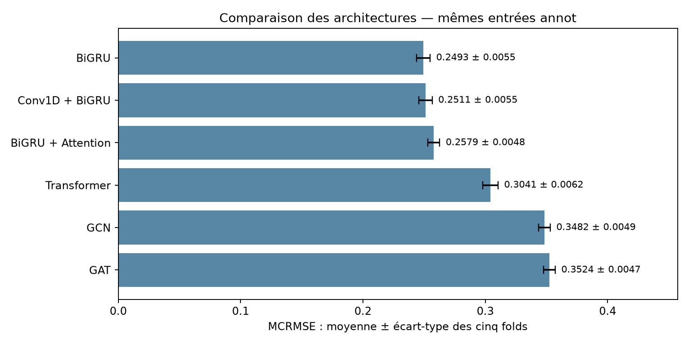
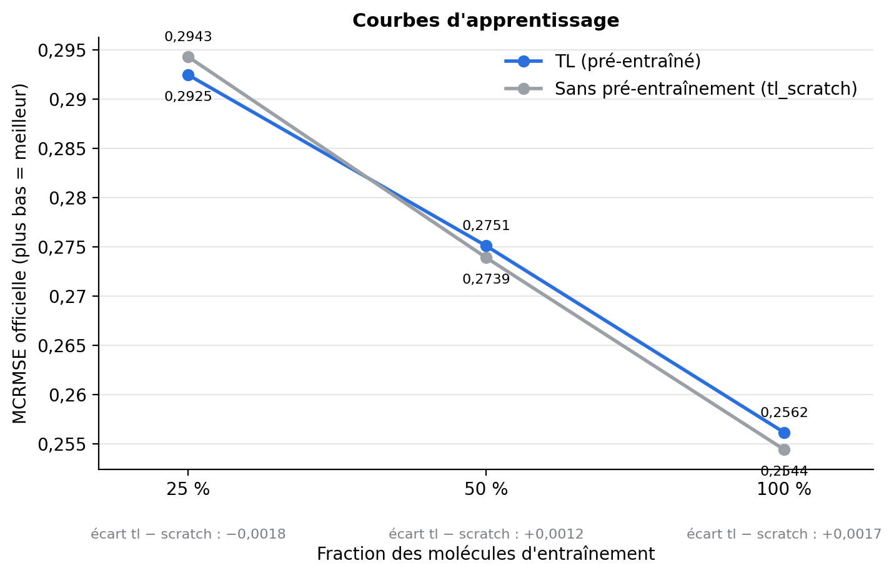
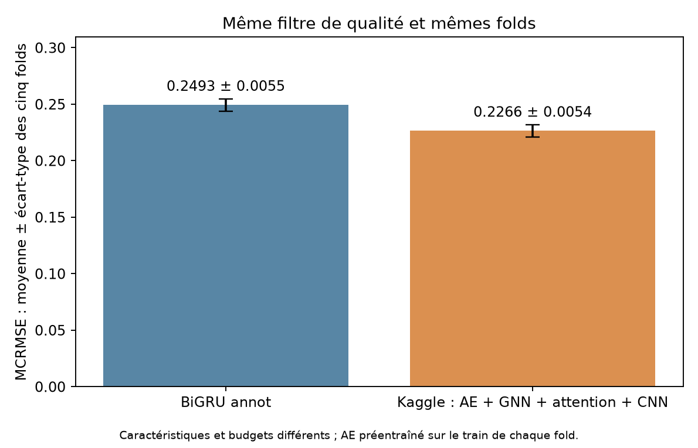

# OpenVaccine : prédiction de la dégradation de l’ARN

Projet du cours IA2, Master 2 Bioinformatique, Université Paris Cité. À partir des données [Stanford OpenVaccine](https://www.kaggle.com/competitions/stanford-covid-vaccine), nous étudions l’apport des informations structurales et du préentraînement à la prédiction de la réactivité et de la dégradation de l’ARN.

## Organisation

Les trois volets sont séparés dans le code et les figures ; ils partagent les données prétraitées, les folds et la métrique officielle.

```text
src/
  preprocessing/       Encodage et caractéristiques communes
  evaluation/          Métrique et format de soumission
  training.py          Utilitaires communs aux entraînements Keras
  models/              Modèles from scratch (Keras)
  transfer/            Transformer avec préentraînement MLM (PyTorch)
  kaggle/              Architecture Kaggle adaptée (Keras)
experiments/
  from_scratch/        Entraînement, comparaison et trois figures du rapport
  transfer/            Préentraînement, fine-tuning et analyses
  kaggle/              Entraînement et vérification de la reproduction adaptée
scripts/               Prétraitement commun et ensemble optionnel
notebooks/             EDA et exécution du transfert sur Colab
figures/
  from_scratch/
  transfer/
  kaggle/
results/transfer/      Tableaux de résultats publiés du transfert
folds/                 Partitions fixes, communes aux trois volets
outputs/               Résultats locaux et checkpoints, ignorés par Git
```

## Installation et données

```bash
python3 -m venv .venv
source .venv/bin/activate
pip install -r requirements.txt
```

Pour le volet PyTorch, installer aussi `pip install -r requirements-transfer.txt`.

Télécharger les données Kaggle dans `data/` : `train.json`, `test.json`, `sample_submission.csv` et les matrices dans `bpps/`. Les JSON compressés en `.json.zip` sont acceptés.

```bash
python -m scripts.preprocess
```

Le prétraitement écrit `train.npz`, `test_107.npz` et `test_130.npz` dans `data/processed/`. Il encode la séquence, la structure et le type de boucle, puis calcule quatre caractéristiques par nucléotide : somme, maximum et entropie BPPS, distance au partenaire. Les cibles et les affectations de `folds/` sont conservées.

## 1. Modèles from scratch

Six architectures sont comparées : BiGRU (baseline), Conv1D + BiGRU, BiGRU + Attention, Transformer, GCN et GAT. Les entrées `annot` sont communes aux six modèles. BiGRU est aussi évalué en `seq` (séquence seule) ; Transformer, GCN et GAT en `graph` (ajout des interactions explicites), soit dix configurations.

```bash
python -m experiments.from_scratch.run --jobs 2
python -m experiments.from_scratch.verify
python -m experiments.from_scratch.figures
```

Les expériences utilisent cinq folds fixes, la seed 42, `SN_filter = 1`, AdamW à 0,001, des lots de 32 et au maximum 40 époques, avec arrêt anticipé après huit époques sans amélioration du MCRMSE officiel. Le test n’intervient pas dans l’apprentissage.

**Résultats :** BiGRU annot obtient **0,24933 ± 0,00553**, suivi de Conv1D + BiGRU à **0,25108 ± 0,00546**. Les annotations réduisent l’erreur moyenne du BiGRU d’environ 19 % par rapport à la séquence seule. Les interactions explicites n’améliorent pas les configurations testées.



Les deux figures complémentaires du rapport sont dans le même dossier : [apport des informations structurales](figures/from_scratch/cv_structure.png) et [erreur par cible](figures/from_scratch/cv_targets.png).

## 2. Préentraînement MLM et fine-tuning

Un Transformer avec biais structuraux apprend à reconstruire des nucléotides masqués, puis prédit les cinq cibles expérimentales. Le même modèle initialisé aléatoirement sert de contrôle pour mesurer l’apport du préentraînement. Aucun modèle de fondation externe n’est utilisé.

```bash
python -m experiments.transfer.pretrain --epochs 100
python -m experiments.transfer.finetune
python -m experiments.transfer.finetune --ckpt none
python -m experiments.transfer.compare --runs tl tl_scratch mean
python -m experiments.transfer.figures
```

La comparaison avec `mean` nécessite ce contrôle : `python -m experiments.from_scratch.train --model mean --name mean`. Le notebook [`Run_transfert.ipynb`](notebooks/Run_transfert.ipynb) contient aussi les expériences avec 25 % et 50 % des données étiquetées.

**Résultats publiés :** MCRMSE OOF **0,25615** avec préentraînement et **0,25442** sans préentraînement à 100 % des données. Le préentraînement n’améliore donc pas le score dans cette configuration. L’accuracy du MLM mesure la reconstruction des bases, pas la qualité de la prédiction de dégradation.



## 3. Adaptation d’une solution Kaggle

Nous adaptons le notebook de [mrkmakr, « AE pretrain + GNN + Attn + CNN »](https://www.kaggle.com/code/mrkmakr/covid-ae-pretrain-gnn-attn-cnn) : autoencodeur débruiteur, convolutions, agrégation sur graphe et attention. Il s’agit d’une architecture communautaire, pas de l’ensemble final du gagnant.

```bash
python -m experiments.kaggle.train
python -m experiments.kaggle.verify
```

Pour cette comparaison, l’autoencodeur est préentraîné séparément sur le train de chaque fold, sans entrées de validation ou de test. Les mêmes 1 589 ARN fiables et les mêmes folds que nos modèles sont utilisés. Les adaptations et la source exacte sont décrites dans [`experiments/kaggle/README.md`](experiments/kaggle/README.md).

**Résultats :** MCRMSE moyenne **0,22657 ± 0,00539** sur cinq folds ; MCRMSE OOF **0,22663**. Cette adaptation obtient une erreur plus faible que notre baseline BiGRU, avec des caractéristiques différentes et 20 époques supplémentaires de préentraînement par fold.



## Évaluation et limites

Chaque modèle prédit cinq cibles sur les 68 positions mesurées. Le MCRMSE officiel porte sur trois cibles : `reactivity`, `deg_Mg_pH10` et `deg_Mg_50C` ; plus bas est meilleur. Les valeurs « moyenne ± écart-type » décrivent les cinq folds, tandis que le score OOF regroupe toutes leurs prédictions.

Les nombres de paramètres, caractéristiques et budgets diffèrent entre volets. Le MLM utilise les entrées de train et de test sans leurs labels, contrairement à notre adaptation Kaggle. Son fine-tuning sélectionne le checkpoint sur les cinq cibles, contre les trois cibles officielles pour les deux autres volets. Les scores comparent donc des pipelines ; ils n’isolent pas uniquement l’effet des architectures. Une seule seed est étudiée et KFold ne garantit pas la séparation des séquences similaires.

Les historiques, poids et prédictions restent dans `outputs/`. Les tests Keras se lancent avec `python -m unittest discover -s tests -v` ; le test du transfert avec `python -m tests.smoke_transfer`.
