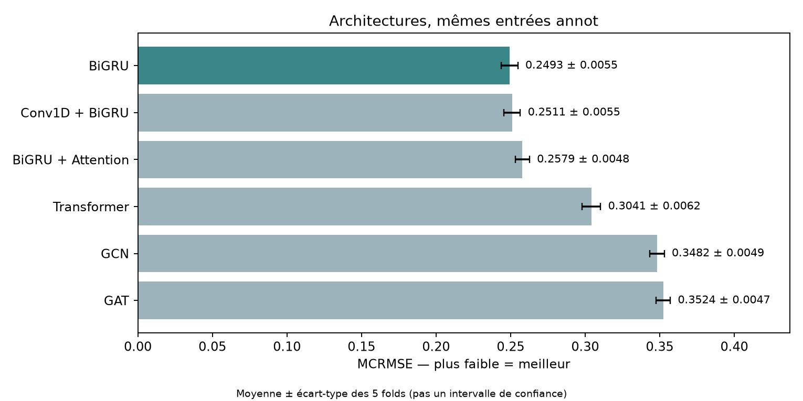

# OpenVaccine : prédiction de la dégradation de l’ARNm

Projet réalisé dans le cadre du cours IA2, à partir du jeu de données [Stanford OpenVaccine](https://www.kaggle.com/competitions/stanford-covid-vaccine).

Nous cherchons à déterminer si les informations de structure secondaire améliorent la prédiction de la réactivité et de la dégradation de l’ARNm. Les modèles effectuent une régression par nucléotide et sont entraînés avec Keras/TensorFlow, à partir de poids initialisés aléatoirement.

## Modèles et entrées

La baseline est un BiGRU à deux couches. Nous la comparons à Conv1D + BiGRU, BiGRU + Attention, un Transformer Encoder, un GCN et un GAT.

Les niveaux d’information sont cumulatifs :

- `seq` : séquence seule ;
- `annot` : séquence, structure secondaire, type de boucle et caractéristiques BPPS par nucléotide ;
- `graph` : mêmes entrées que `annot`, avec des interactions explicites entre nucléotides.

Les six architectures sont comparées avec les entrées `annot`. BiGRU est aussi évalué en `seq`, et Transformer, GCN et GAT en `graph`, soit dix configurations au total. Dans le Transformer, les BPPS servent de biais d’attention. Le GCN utilise leurs probabilités comme poids ; le GAT les utilise pour sélectionner les voisins, avec un seuil de 0.1.

## Installation et données

```bash
python3 -m venv .venv
source .venv/bin/activate
pip install -r requirements.txt
```

Télécharger les données depuis Kaggle et les placer dans `data/` :

```text
data/
├── train.json
├── test.json
├── sample_submission.csv
└── bpps/
```

Les fichiers JSON compressés en `.json.zip` sont également acceptés. Le prétraitement prépare les entrées et les enregistre dans `data/processed/` :

```bash
python preprocess.py
```

Les folds fournis dans `folds/` sont communs à toutes les expériences et doivent être conservés.

## Entraînement et évaluation

Les dix configurations ont été évaluées sur cinq folds KFold fixes, avec la seed 42. Nous utilisons AdamW, un taux d’apprentissage initial de 1e-3, un batch de 32 et un maximum de 40 époques. L’arrêt anticipé intervient après huit époques sans amélioration de la MCRMSE de validation. Les molécules avec `SN_filter = 0` sont exclues de l’entraînement et de la validation dans ces expériences.

Chaque modèle prédit cinq valeurs par position. La loss porte sur les 68 premières positions annotées ; la MCRMSE est calculée sur les trois cibles officielles : `reactivity`, `deg_Mg_pH10` et `deg_Mg_50C`. Une valeur plus faible indique une meilleure prédiction. Le test Kaggle n’est pas utilisé pour le réglage ou la sélection des modèles.

Pour lancer un pilote sur le fold 0 :

```bash
python train.py --model gru --level annot --only-fold 0 \
  --epochs 40 --patience 8 --skip-test --name gru_pilote
```

Pour reproduire la comparaison complète :

```bash
python experiments/run_comparison.py
python experiments/run_comparison.py --five-fold --reuse-pilots --jobs 2
python experiments/verify_outputs.py
python experiments/summarize.py
```

La seconde commande réutilise les folds 0 compatibles et entraîne les quatre autres folds. Les configurations, historiques, meilleurs poids et prédictions OOF sont enregistrés dans `outputs/`. Les expériences existantes ne sont pas écrasées.

Les tests de dimensions, gradients et checkpoints se lancent avec :

```bash
python -m unittest discover -s tests -v
```

## Résultats et figures

BiGRU avec les entrées `annot` obtient la plus faible MCRMSE moyenne : **0.24933 ± 0.00553**. Conv1D + BiGRU reste proche, à **0.25108 ± 0.00546**. Les annotations réduisent l’erreur moyenne du BiGRU d’environ 19 % par rapport à la séquence seule. L’ajout d’interactions explicites n’améliore pas les Transformer, GCN et GAT testés.

Ces résultats concernent nos configurations et notre budget d’entraînement. Les nombres de paramètres diffèrent et une seule seed a été utilisée ; ils ne démontrent pas une supériorité générale d’une famille de modèles.



Les autres figures sont dans [`figures/`](figures/), notamment :

- [Contribution des informations structurales](figures/cv_structure.png)
- [Erreur par cible](figures/cv_targets.png)
- [Courbes d’apprentissage du BiGRU](figures/cv_gru_annot_learning.png)
- [Valeurs réelles et prédites par le BiGRU](figures/cv_gru_annot_actual_predicted.png)

Les données, poids, tableaux de résultats et notes locales ne sont pas versionnés.
